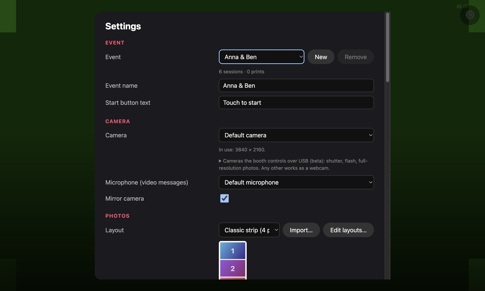

<p align="center"></p>

<h1 align="center">Open Photo Booth</h1>

<p align="center">
  <b>Free, open-source photo booth software for Windows and macOS.</b><br>
  No account. No subscription. No internet required. Your photos never leave your computer.
</p>

<p align="center">
  <a href="https://github.com/robert-schmidt/open-photo-booth/releases/latest"></a>
  <a href="LICENSE"></a>
  
</p>

<p align="center"></p>

---

## Contents

- [Why Open Photo Booth?](#why-open-photo-booth)
- [Who is it for?](#who-is-it-for)
- [Features](#features)
- [Download and install](#download-and-install)
- [Quick start](#quick-start)
- [How to use it](#how-to-use-it)
  - [The guest experience](#the-guest-experience)
  - [Operator controls and settings](#operator-controls-and-settings)
  - [Cameras](#cameras)
  - [Layouts and the layout editor](#layouts-and-the-layout-editor)
  - [Printing](#printing)
  - [Where your photos go](#where-your-photos-go)
  - [Running an event: checklist](#running-an-event-checklist)
- [Privacy](#privacy)
- [Troubleshooting](#troubleshooting)
- [FAQ](#faq)
- [Roadmap](#roadmap)
- [Development](#development)
- [Support the project](#support-the-project)
- [License](#license)

## Why Open Photo Booth?

Most photo booth software is sold as a monthly subscription, tied to an online account, and often limited per device. To take a few photos, put them in a nice layout and print them, you're asked to sign in, stay online and keep paying.

Open Photo Booth is the opposite:

- **Free forever.** MIT-licensed, including for paid events and photo booth rental businesses.
- **No account, no sign-in, no license keys.** Install it and start shooting.
- **Works fully offline.** Banquet halls, barns and beaches rarely have good Wi-Fi. The booth doesn't need any.
- **You own your photos.** Every shot is saved as a plain JPG on your computer. Nothing is uploaded and there's no watermark.
- **Open and hackable.** The code is small and readable, and layouts are plain XML files. Fix what bothers you, add what you need, and share it back.

## Who is it for?

- **Event and wedding photographers** who want to offer a booth as an add-on without another subscription.
- **Photo booth rental businesses** running several booths without per-device fees.
- **Couples, families and party hosts** building a DIY booth from a laptop, a webcam and a printer.
- **Venues, bars, restaurants and hotels** that want a self-service booth for guests.
- **Schools, companies and community groups** for graduations, conferences, open days and team events.
- **Makers and developers** who want a solid base for a custom booth.

## Features

| | |
|---|---|
| **Guest flow** | Touch-to-start screen with a live, mirrored preview, then a big countdown, a flash effect and a review screen with Retake / Print / Done |
| **Multi-shot sessions** | The layout decides how many photos are taken (1–N), with a pause between shots |
| **Layouts** | Classic 2×6 strip, postcard (1 large + 3 small), grid of four and single photo, plus your own |
| **Layout editor** | Create, edit, duplicate and delete layouts visually: photo slots, text, images/overlays, rectangles and ellipses. Drag to move and resize, adjust colours, opacity, borders, shadows, rotation and layer order, with undo/redo |
| **Template import** | Import any folder with a `template.xml` (the format used by dslrBooth/LumaBooth-style templates) |
| **Text placeholders** | `{event}` and `{date}` are filled in automatically; text shrinks to fit its box |
| **Filters** | None, black & white, sepia, warm, vivid, faded, with a live preview in settings |
| **Printing** | Any printer your OS supports (dye-sub, inkjet, laser). Silent printing to a chosen printer, auto-print, copies, and 2×6 strips printed 2-up on 4×6 paper |
| **Storage** | Each session is saved immediately (individual shots and the final layout) in a folder per event |
| **Kiosk mode** | Fullscreen, the display never sleeps, settings hidden behind a long-press, optional PIN |
| **Buttons and pedals** | `Space` / `Enter` start a session, so USB foot pedals, arcade buttons and wireless presenters work out of the box |
| **Cameras** | Any webcam, or a DSLR/mirrorless camera through its webcam utility or an HDMI capture card |

## Download and install

Download the latest version from the **[Releases page](https://github.com/robert-schmidt/open-photo-booth/releases/latest)**:

| System | File |
|---|---|
| macOS, Apple Silicon (M1 or newer) | `Open-Photo-Booth-<version>-mac-arm64.dmg` |
| macOS, Intel | `Open-Photo-Booth-<version>-mac-x64.dmg` |
| Windows 10 / 11 (64-bit) | `Open-Photo-Booth-<version>-win-x64.exe` |

**macOS:** open the `.dmg` and drag **Open Photo Booth** into **Applications**. The app is free and not signed with a paid Apple developer certificate, so the first launch needs one extra step: right-click the app → **Open** → **Open**. If macOS still refuses, go to **System Settings → Privacy & Security** and click **Open Anyway**. Allow camera access when asked.

**Windows:** run the installer. If SmartScreen shows "Windows protected your PC", click **More info → Run anyway**. Make sure **Settings → Privacy & security → Camera → Let desktop apps access your camera** is on.

## Quick start

1. **Connect** your camera (and printer, if you print).
2. **Start** Open Photo Booth. You'll see the live camera and a "Touch to start" button.
3. **Open settings** by holding the **top-right corner** of the screen for 1.5 seconds, or pressing **Ctrl + ,** (Windows) / **Cmd + ,** (Mac).
4. **Set** your event name, camera, layout and printer, then **Save**.
5. Turn on **Fullscreen kiosk**, step back, and let your guests have fun.

## How to use it

### The guest experience

1. The **start screen** shows the live camera with your event name and a pulsing start button. Guests tap anywhere, or press a connected button or pedal.
2. A **countdown** appears for each photo, followed by a flash. "Photo 2 of 4" shows how many photos are left.
3. The **review screen** shows the finished layout:
   - **Retake** starts over. The previous photos are still kept on disk.
   - **Print** prints the layout (once per session, so prints aren't wasted).
   - **Done** returns to the start screen. If nobody touches anything, the booth returns there automatically after the review time.

### Operator controls and settings

Open settings by **holding the top-right corner for 1.5 seconds** or pressing **Ctrl/Cmd + ,**. If you set a PIN, it's asked for first.

<p align="center"></p>

| Setting | What it does |
|---|---|
| **Event name** | Shown on the start screen, used for `{event}` in layouts and as the folder name for this event's photos |
| **Start button text** | The text on the start button ("Touch to start", "Tap for photos!", in any language) |
| **Camera** | Which camera to use; *Default camera* uses the system default |
| **Mirror camera** | Flips the preview and photos like a mirror (what most guests expect) |
| **Layout** | The layout used for sessions; the preview below updates as you choose. **Import…** adds a template folder; **Edit layouts…** opens the layout editor |
| **Filter** | Colour filter applied to the photos in the layout (the preview shows it) |
| **Countdown** | Seconds counted down before each photo (0 = instant) |
| **Pause between photos** | Seconds between shots in a multi-photo session so guests can change poses |
| **Review screen** | Seconds before the review screen returns to the start screen on its own |
| **Save photos to** | The main photos folder; each event gets a subfolder |
| **Printer** | *Ask each time* shows the print dialog; choosing a printer prints silently |
| **Copies** | Copies per print |
| **Print automatically** | Prints every session without anyone pressing Print |
| **Print strips 2-up (4×6)** | Prints a 2×6 strip twice side by side on 4×6 paper, ready to cut in half |
| **Fullscreen kiosk** | Locks the booth fullscreen. Use **Quit** in settings to close the app |
| **Settings PIN** | If set, the PIN is required to open settings; leave empty to disable |

The settings window also has **Open photos** (opens the current event folder) and **Quit**.

### Cameras

Open Photo Booth uses your operating system's camera system, so anything that shows up as a camera works:

- **Webcams.** Any USB webcam or the built-in one. A 1080p or 4K webcam with good light gives great results; the booth asks the camera for up to 4K.
- **DSLR and mirrorless cameras.** Install your camera maker's free webcam utility, connect the camera by USB, and choose it under **Settings → Camera**:
  - Canon: *EOS Webcam Utility*
  - Sony: *Imaging Edge Webcam*
  - Nikon: *Webcam Utility*
  - Fujifilm: *X Webcam*
  - Panasonic: *LUMIX Webcam Software*
- **HDMI capture cards.** Most cameras with a clean HDMI output work through an inexpensive HDMI-to-USB capture card and show up as a webcam.

Tips: light matters more than the camera. One soft light in front of guests (a ring light or softbox) makes a huge difference. Use a tripod and keep the camera at eye level.

### Layouts and the layout editor

A **layout** defines the final picture: its size, where each photo goes, and any text, shapes or graphics around them. Four layouts are included:

<p align="center"></p>

#### Using the layout editor

Open **Settings → Edit layouts…**.

<p align="center"></p>

- **Left panel:**
  - **Layouts** lists every layout. Built-in layouts are read-only; saving one creates your own copy.
  - **Use in booth** makes the selected layout the active one.
  - **Delete** removes one of your own layouts.
  - **New layout** starts a blank layout from a paper size: 2×6 strip, 4×6 landscape or portrait, 5×7 landscape or portrait, square 4×4, or 6×8 portrait.
  - **Add element** adds a **Photo slot**, **Text**, **Image**, **Rectangle** or **Ellipse**.
- **Canvas:** click an element to select it, drag to move it, and drag the small corner square to resize it. Hold **Shift** while resizing to keep the proportions. Click empty space to edit the layout itself (name, paper size, pixel size, DPI, background colour).
- **Right panel:** every property of the selected element. Colours have a picker plus a slider for transparency.

  | Element | Properties |
  |---|---|
  | All elements | Name, X/Y position, width/height, rotation, opacity, border width and colour, drop shadow (colour, distance, blur, angle) |
  | Photo slot | **Photo number**: slot 1 gets the first shot, slot 2 the second, and so on. The highest number decides how many photos a session takes, and two slots with the same number repeat that photo |
  | Text | Text (with `{event}` and `{date}` placeholders), font, size, colour, alignment |
  | Image | The image file (PNG with transparency is ideal for frames, logos and overlays), keep proportions |
  | Rectangle / Ellipse | Fill colour (use the transparency slider for tinted or hollow shapes) |

  Buttons: **Duplicate**, **To front / Forward / Backward / To back** (layer order), **Center ↔ / Center ↕**, **Delete**.
- **Saving:** **Save** updates your layout (or creates a copy of a built-in one). **Save as copy** always creates a new layout. Images you add are copied into the layout's folder, so the layout keeps working even if the originals move.

**Keyboard shortcuts in the editor**

| Keys | Action |
|---|---|
| Arrow keys | Nudge the selection 1 px (with Shift: 10 px) |
| Delete / Backspace | Delete the selection |
| Ctrl/Cmd + D | Duplicate |
| Ctrl/Cmd + Z | Undo |
| Ctrl/Cmd + Shift + Z or Ctrl + Y | Redo |
| Ctrl/Cmd + S | Save |
| Esc | Deselect (edit the layout itself) |

**Designing for print:** sizes are in pixels at the layout's DPI (300 DPI is standard for photo printers), so a 2×6-inch strip is 600×1800 px and a 4×6 print is 1800×1200 px. Keep important content about 40 px from the edges, because most printers trim a little.

#### Importing templates and the file format

**Settings → Layout → Import…** accepts a folder containing a `template.xml` and the images it references. (Got a `.zip`? Unzip it first.) This is the format used by dslrBooth/LumaBooth-style templates, so many existing layouts import directly. Unsupported elements, such as QR codes, are skipped.

Your layouts are stored as plain files, so you can back them up, share them, or edit them by hand:

- macOS: `~/Library/Application Support/Open Photo Booth/templates/`
- Windows: `%APPDATA%\Open Photo Booth\templates\`

```xml
<?xml version="1.0" encoding="UTF-8"?>
<Template Name="My strip" Width="600" Height="1800" Resolution="300" BackgroundColor="#FFFFFFFF">
  <Elements>
    <Photo Name="Photo 1" PhotoNumber="1" Left="30" Top="30" Width="540" Height="360" ZIndex="0" />
    <Image Name="Logo" ImagePath="logo.png" KeepAspect="True" Left="150" Top="1560" Width="300" Height="200" ZIndex="1" />
    <Text Name="Title" Text="{event} · {date}" FontName="Georgia" FontSize="48" FontColor="#FF222222"
          TextAlignment="Center" Left="0" Top="1420" Width="600" Height="120" ZIndex="2" />
  </Elements>
</Template>
```

| Attribute | Applies to | Meaning |
|---|---|---|
| `Width`, `Height`, `Resolution` | Template | Canvas size in pixels and DPI |
| `BackgroundColor` | Template | Background colour, `#AARRGGBB` (alpha first) |
| `Left`, `Top`, `Width`, `Height` | All elements | Position and size in pixels |
| `Rotation`, `Opacity`, `ZIndex` | All elements | Degrees; 0–100; paint order (higher is on top) |
| `Thickness`, `StrokeColor` | All elements | Border width and colour |
| `ShadowEnabled`, `ShadowColor`, `ShadowDepth`, `ShadowRadius`, `ShadowDirection` | All elements | Drop shadow |
| `PhotoNumber` | Photo | Which shot goes in this slot |
| `ImagePath`, `KeepAspect` | Image | File name inside the template folder; fit without stretching |
| `Text`, `FontName`, `FontSize`, `FontColor`, `TextAlignment` | Text | Text content and style (`Left`, `Center`, `Right`) |
| `Fill` | Rectangle, Ellipse | Fill colour |

### Printing

Open Photo Booth prints through your operating system, so any installed printer works: dye-sublimation event printers (DNP, Citizen, Mitsubishi, HiTi, Canon SELPHY), photo inkjets and regular printers.

1. Install the printer's driver and print a test page from your OS first.
2. In the printer's **default settings** in Windows or macOS, set the paper size (for example 4×6 / 6×4 in), borderless printing and, for strips, the driver's 2-inch cut option if your printer has one. Silent printing uses these defaults.
3. In **Settings → Printer**, choose the printer (silent printing) or leave *Ask each time* to see the print dialog for every print.
4. Strip layouts (2×6) are printed **2-up** on a 4×6 sheet when **Print strips 2-up** is on, so one sheet gives two strips.
5. Turn on **Print automatically** if every guest should get a print.

The print size comes from the layout (`Width ÷ Resolution` inches), and the image is scaled to fill the page without distortion.

### Where your photos go

Every session is saved the moment it's captured, before anyone presses a button:

```
Pictures/Open Photo Booth/<event name>/
  20261018-201530.jpg          ← the finished layout
  20261018-201530_1.jpg        ← individual shots, full camera resolution
  20261018-201530_2.jpg
  ...
  20261018-201530_print.jpg    ← the 2-up print sheet (strips only, when printed)
```

Use **Settings → Open photos** to jump to the folder. Change the location with **Save photos to**, for example to a USB drive or a synced folder.

### Running an event: checklist

- [ ] Camera connected, on a tripod, well lit; the right camera chosen in settings
- [ ] Event name set (it appears on the prints and names the folder)
- [ ] Layout chosen and previewed; a test session printed
- [ ] Printer loaded with enough paper and ribbon; the right paper size in the driver defaults
- [ ] Computer plugged into power, with OS updates and notifications paused
- [ ] **Fullscreen kiosk** on and a **Settings PIN** set
- [ ] At the end: **Settings → Open photos** and copy the event folder somewhere safe

## Privacy

Open Photo Booth has **no accounts, no cloud, no analytics and no telemetry**. It makes no network connections. Photos, settings and layouts are stored only on your computer, in the folders listed above. Delete them whenever you like.

## Troubleshooting

| Problem | Fix |
|---|---|
| "No camera found" or a black preview | Check the camera is connected and not used by another app (Zoom, Teams, the camera utility's own app). macOS: **System Settings → Privacy & Security → Camera** → enable Open Photo Booth. Windows: **Settings → Privacy & security → Camera** → allow desktop apps. Then pick the camera in settings |
| The DSLR doesn't appear | Install and start the maker's webcam utility, set the camera to video/movie mode if required, reconnect USB and restart the booth |
| The photo looks low-resolution | Some webcam utilities are limited to 1080p. A capture card or a 4K webcam gives more pixels; good light helps the most |
| Prints have white borders or the wrong size | Set the paper size and borderless printing in the printer's **default** settings in the OS (silent printing uses them) |
| macOS: "can't be opened" or "damaged" | Right-click the app → Open; or System Settings → Privacy & Security → Open Anyway. As a last resort: `xattr -cr "/Applications/Open Photo Booth.app"` |
| Windows SmartScreen warning | Click **More info → Run anyway** (the app isn't signed with a paid certificate) |
| Forgot the settings PIN | Quit the app (Alt+F4 / Cmd+Q) and clear the `"pin"` value in `settings.json`: macOS `~/Library/Application Support/Open Photo Booth/settings.json`, Windows `%APPDATA%\Open Photo Booth\settings.json` |

## FAQ

**Is it really free, also for commercial use?** Yes. It's MIT-licensed: use it at paid events, in a rental business, or as the base for your own product.

**Do I need an account or an internet connection?** No, never.

**Does it add a watermark?** No. Add your own logo with an Image element if you want one.

**Can it control my DSLR directly (settings, autofocus, full-resolution capture)?** Not yet. Today a DSLR works through its webcam utility. Direct camera control is on the roadmap.

**Does it run on Linux or a Raspberry Pi?** It's built with Electron, so it may run from source on Linux, but only Windows and macOS are tested and released.

**Can guests get their photos on their phone?** Not yet. QR-code sharing over the local network is on the roadmap.

## Roadmap

Ideas for future versions (contributions welcome):

- GIF and boomerang capture
- QR-code sharing to guests' phones over local Wi-Fi (still no cloud)
- Green screen / background replacement
- Direct DSLR control (gPhoto2 / vendor SDKs) with full-resolution capture
- Start screen backgrounds and attract-mode slideshow
- Retake a single photo within a session
- `.cube` colour presets (LUT filters)
- Stickers and on-screen drawing

## Development

Requirements: Node.js 22 or newer and npm.

```bash
git clone https://github.com/robert-schmidt/open-photo-booth.git
cd open-photo-booth
npm install
npm start      # run the app
npm test       # layout model and template self-check
npm run e2e    # drive the real app with a fake camera: session, PIN, layout editor
npm run dist   # build installers for your OS into dist/
```

The app is deliberately small and dependency-free at runtime:

| File | Purpose |
|---|---|
| `main.js` | Electron main process: window, settings, file storage, templates, printing |
| `preload.js` | The small, explicit API the UI may call (`window.booth`) |
| `index.html` | Screens, settings dialog, layout editor markup and styles |
| `app.js` | Booth flow: camera, countdown, capture, compositing, review, printing, settings |
| `editor.js` | The visual layout editor |
| `layout.js` | Template model: parse/serialize `template.xml`, colour and fitting maths (shared with tests) |
| `templates/` | Built-in layouts |
| `test.js` | Self-check: `npm test` |
| `e2e.mjs` | End-to-end check in a throwaway profile: `npm run e2e`. `npm run e2e -- docs` also refreshes the README screenshots |

**Releasing:** add your changes to `CHANGELOG.md`, bump `version` in `package.json`, commit, then tag:

```bash
git tag v0.2.0 && git push origin main v0.2.0
```

GitHub Actions builds the macOS (Apple Silicon and Intel) and Windows installers and publishes them on the Releases page with the changelog entry as release notes.

Contributions are welcome: open an issue to discuss bigger changes, keep pull requests focused, and run `npm test` and `npm run e2e` before submitting.

## Support the project

Open Photo Booth is free and always will be. If it saved you a subscription or made your event better, consider a donation to keep development going:

| Network | Address |
|---|---|
| **Solana** (SOL, USDC, …) | `E8tLUC1RhBpRoF1we4onS5MkmpDQVVRvrqbE6Pyhufon` |
| **EVM** (Ethereum, Base, Arbitrum, Polygon, BNB Chain, … ETH and tokens) | `0xaAC0B63a317217675985CC78b7750e6DEfEFf119` |
| **Bitcoin** | `bc1qvg5uvqahyarfcnxmsuds9pvvu56kyekn3hwjf3` |

Starring the repository, reporting bugs and sharing layouts help a lot too.

## License

[MIT](LICENSE) © Open Photo Booth contributors.

Open Photo Booth is an independent project. It is not affiliated with or endorsed by Lumasoft, LumaBooth or dslrBooth; those names are used only to describe compatibility with their template file format. Camera and printer brand names belong to their owners.
