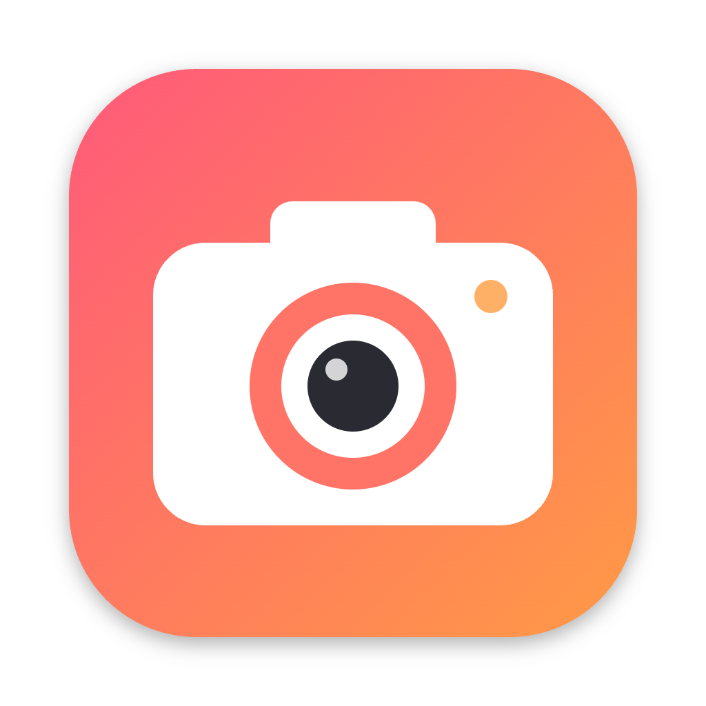
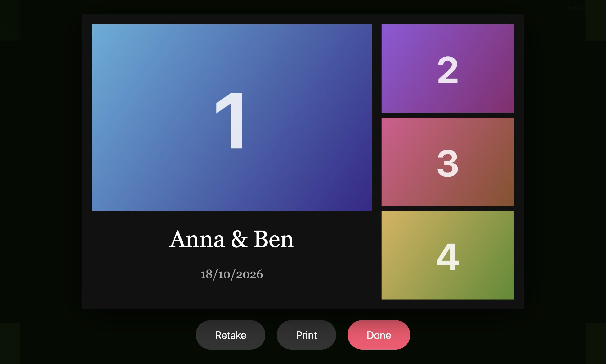
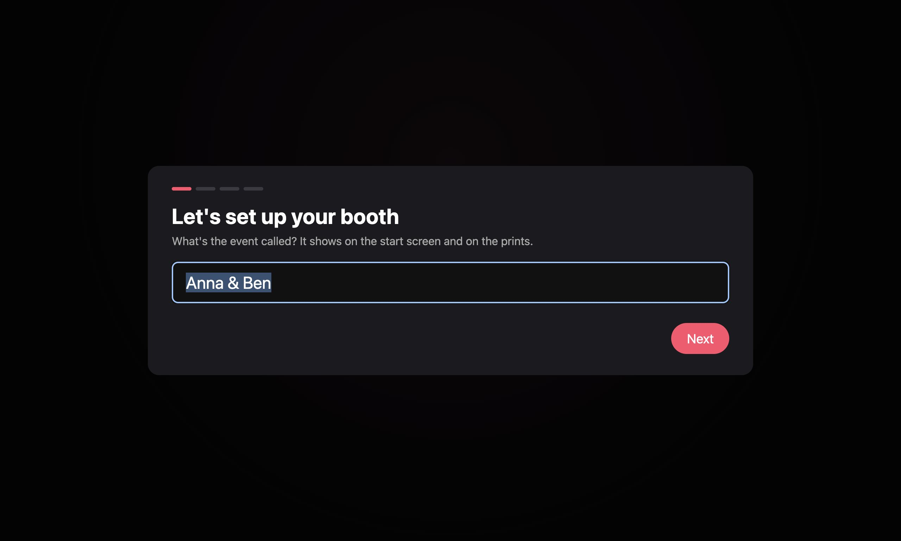
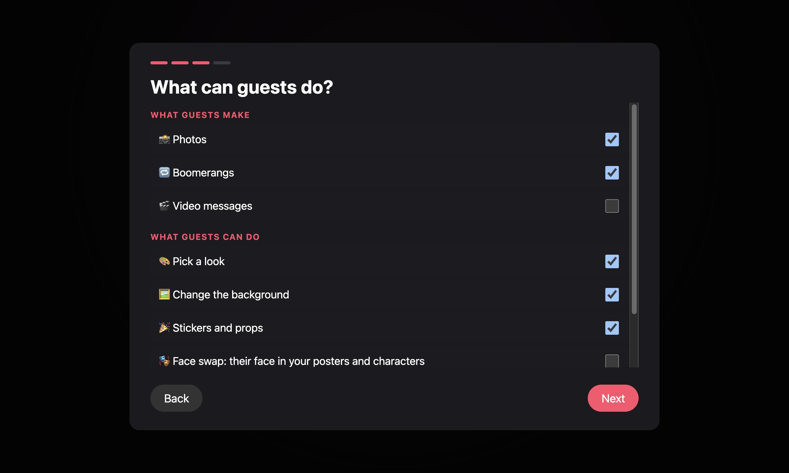
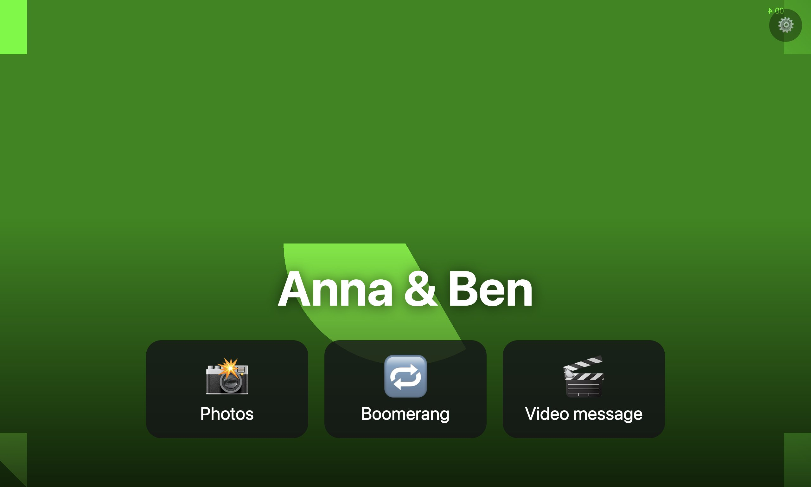
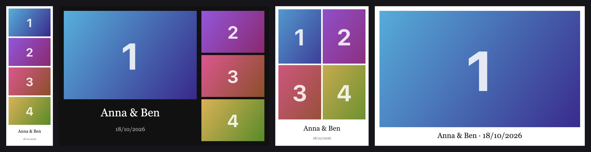
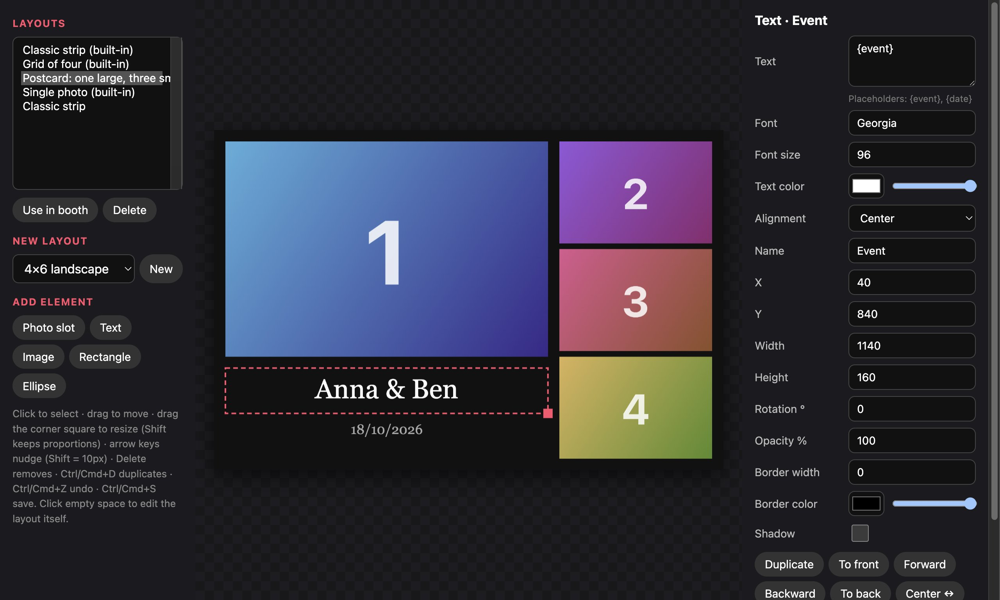

<p align="center"></p>

<h1 align="center">Open Photo Booth</h1>

<p align="center">
  <b>Free, open-source photo booth software for Windows and macOS.</b><br>
  No account. No subscription. No internet required. Your photos never leave your computer.
</p>

<p align="center">
  <a href="https://github.com/robert-schmidt/open-photo-booth/releases/latest"></a>
  <a href="LICENSE"></a>
  
</p>

<p align="center"></p>

---

## Contents

- [Why Open Photo Booth?](#why-open-photo-booth)
- [Who is it for?](#who-is-it-for)
- [Features](#features)
- [Looking for more? Try Boothini](#looking-for-more-try-boothini)
- [Download and install](#download-and-install)
- [Quick start](#quick-start)
- [How to use it](#how-to-use-it)
  - [The guest experience](#the-guest-experience)
  - [Operator controls and settings](#operator-controls-and-settings)
  - [Cameras](#cameras)
  - [Face swap](#face-swap)
  - [Layouts and the layout editor](#layouts-and-the-layout-editor)
  - [Printing](#printing)
  - [Where your photos go](#where-your-photos-go)
  - [Running an event: checklist](#running-an-event-checklist)
- [Privacy](#privacy)
- [Troubleshooting](#troubleshooting)
- [FAQ](#faq)
- [Roadmap](#roadmap)
- [Development](#development)
- [Support the project](#support-the-project)
- [License](#license)

## Why Open Photo Booth?

Most photo booth software is sold as a monthly subscription, tied to an online account, and often limited per device. To take a few photos, put them in a nice layout and print them, you're asked to sign in, stay online and keep paying.

Open Photo Booth is the opposite:

- **Free forever.** MIT-licensed, including for paid events and photo booth rental businesses.
- **No account, no sign-in, no license keys.** Install it and start shooting.
- **Works fully offline.** Banquet halls, barns and beaches rarely have good Wi-Fi. The booth doesn't need any.
- **You own your photos.** Every shot is saved as a plain JPG on your computer. Nothing is uploaded and there's no watermark.
- **Open and hackable.** The code is small and readable, and layouts are plain XML files. Fix what bothers you, add what you need, and share it back.

## Who is it for?

- **Event and wedding photographers** who want to offer a booth as an add-on without another subscription.
- **Photo booth rental businesses** running several booths without per-device fees.
- **Couples, families and party hosts** building a DIY booth from a laptop, a webcam and a printer.
- **Venues, bars, restaurants and hotels** that want a self-service booth for guests.
- **Schools, companies and community groups** for graduations, conferences, open days and team events.
- **Makers and developers** who want a solid base for a custom booth.

## Features

| | |
|---|---|
| **Guest flow** | Touch-to-start screen with a live, mirrored preview, then a big countdown framed like the photo, a flash and an editing screen that finishes by itself |
| **Setup guide** | On first launch and for every new event, a few steps name the event, pick its layout and choose what guests can do |
| **Events** | As many events as you like, each with its own settings, dated photo folder and session count; switch between them in the settings |
| **Photos, boomerangs, videos** | Guests take photos, a boomerang (saved as MP4, with a flip-book print) or a video message with sound. You choose which are on offer |
| **Editing screen** | Guests pick a look for all photos or one, retake a single photo, change the background, add stickers and face props, then Print or Done |
| **Looks** | Black & white, sepia, warm, vivid, faded, comic and sketch, shown as thumbnails of the guest's own photo, plus auto-enhance |
| **Backgrounds** | Blur, studio and themed backdrops or your own images, cut out on the booth itself; or a real green screen with adjustable tolerance |
| **Glam and no-blink** | Light or strong skin smoothing, and the booth keeps the frame where nobody blinked |
| **Stickers and props** | Emoji and your own PNGs, moved, resized and turned with fingers; glasses, hats and crowns land on every face |
| **Face swap** | Guests put their faces into your scenes (posters, characters, covers), or become a character live on the start screen. Runs on the booth, after a one-time download of its models, see [Face swap](#face-swap) |
| **Camera control** | Recent Sony and Nikon Z cameras over USB (beta): live view, the camera's own shutter and flash, full-resolution files |
| **Multi-shot sessions** | The layout decides how many photos are taken (1–N), with a pause between shots |
| **Layouts** | Classic 2×6 strip, postcard (1 large + 3 small), grid of four and single photo, plus your own |
| **Layout editor** | Create, edit, duplicate and delete layouts visually: photo slots, text, images/overlays, rectangles and ellipses. Drag to move and resize, adjust colours, opacity, borders, shadows, rotation and layer order, with undo/redo |
| **Template import** | Import any folder with a `template.xml` (the format used by dslrBooth/LumaBooth-style templates) |
| **Text placeholders** | `{event}` and `{date}` are filled in automatically; text shrinks to fit its box |
| **Printing** | Any printer your OS supports (dye-sub, inkjet, laser). Silent printing to a chosen printer, auto-print, copies, and 2×6 strips printed 2-up on 4×6 paper |
| **Storage** | Each session is saved immediately (individual shots and the final layout) in a dated folder per event, with originals, prints and videos in folders of their own |
| **Kiosk mode** | Fullscreen, the display never sleeps, settings behind the ⚙️ button and an optional PIN |
| **Buttons and pedals** | `Space` / `Enter` start a session, so USB foot pedals, arcade buttons and wireless presenters work out of the box |
| **Other cameras** | Any webcam, or any DSLR/mirrorless camera through its webcam utility or an HDMI capture card |

## Looking for more? Try Boothini

[**Boothini**](https://boothini.com/) is Open Photo Booth with online extras, from the same developer. Everything on this page is in it, and it adds:

- **AI magic.** Guests turn their photo into pop art, anime, an oil painting, a 3D cartoon, a superhero or a vintage portrait, in about 15 seconds. For a themed event, every photo can get one style by itself.
- **Photos from anywhere.** A QR code that works on any phone, with no shared Wi-Fi; the photo by email; and a gallery page for the whole event, kept for 90 days.

Boothini is free to download for macOS and Windows, with no plan and no subscription. Credits pay for the online extras, only when you use them: 1 credit for an AI photo, 50 credits for an event shared online. An account comes with 30 credits, and its first shared event is free.

Open Photo Booth stays free and open source, and nothing in it needs an account.

## Download and install

Download the latest version from the **[Releases page](https://github.com/robert-schmidt/open-photo-booth/releases/latest)**:

| System | File |
|---|---|
| macOS, Apple Silicon (M1 or newer) | `Open-Photo-Booth-<version>-mac-arm64.dmg` |
| macOS, Intel | `Open-Photo-Booth-<version>-mac-x64.dmg` |
| Windows 10 / 11 (64-bit) | `Open-Photo-Booth-<version>-win-x64.exe` |

**macOS:** open the `.dmg` and drag **Open Photo Booth** into **Applications**. From 0.3.2 the app is signed and notarized by Apple, so it opens like any other app. Allow camera access when asked.

**Windows:** run the installer. If SmartScreen shows "Windows protected your PC", click **More info → Run anyway**. Make sure **Settings → Privacy & security → Camera → Let desktop apps access your camera** is on.

## Quick start

1. **Connect** your camera (and printer, if you print).
2. **Start** Open Photo Booth. The first time, a short **setup guide** asks for the event's name, its layout and what guests can do.
3. The start screen appears with the live camera. **Open settings** with the **⚙️ in the top-right corner**, or by pressing **Ctrl + ,** (Windows) / **Cmd + ,** (Mac).
4. **Set** your camera and printer, then **Save**.
5. Turn on **Fullscreen kiosk**, step back, and let your guests have fun.

<p align="center"> </p>

## How to use it

### The guest experience

<p align="center"> </p>

1. The **start screen** shows the live camera with your event name. Guests tap anywhere, or press a connected button or pedal. If the event offers boomerangs or video messages too, they pick one of three big buttons.
2. A **countdown** appears for each photo, with the preview cut to the shape of the photo, followed by a flash. "Photo 2 of 4" shows how many photos are left.
3. The **editing screen** shows the finished layout, with whichever tools the event allows:
   - **Look**, **Background**, **Face swap** and **Stickers** apply to all photos; tap one photo to change only that one.
   - **Retake** replaces a single photo and keeps the other edits.
   - **Print** prints the layout (once per session, so prints aren't wasted).
   - **Done** returns to the start screen. If nobody touches anything, the booth finishes by itself after the idle time, shown as a shrinking bar on the Done button.

### Operator controls and settings

Open settings with the **⚙️ in the top-right corner of the start screen** or by pressing **Ctrl/Cmd + ,**. Guests can tap the ⚙️ too, so set a **Settings PIN** for an event (the setup guide offers it); it's asked for first.

<p align="center"></p>

| Setting | What it does |
|---|---|
| **Event**, **New**, **Remove** | The event in use. **New** starts another one as a copy of the current event and opens the setup guide. **Remove** takes an event off the list; its photos stay |
| **Event name** | Shown on the start screen, used for `{event}` in layouts and in the name of this event's photo folder |
| **Start button text** | The text on the start button ("Touch to start", "Tap for photos!", in any language) |
| **Start screen pictures** | A folder of images shown on the start screen in place of the camera view: one is a background, several play as a slideshow until a guest starts. (Not with live face swap characters, where guests need to see themselves) |
| **Camera** | Which camera to use. A camera the booth controls is marked *controlled over USB*; the line below says what the camera in use delivers, and **Test shot** takes one photo with it |
| **Microphone** | For video messages |
| **Mirror camera** | Flips the preview and photos like a mirror (what most guests expect) |
| **Layout** | The layout used for sessions; the preview below updates as you choose. **Import…** adds a template folder; **Edit layouts…** opens the layout editor |
| **Default look** | The look photos start with; guests can change it if **Guests pick a look** is on |
| **Auto-enhance photos** | Fixes washed-out or tinted photos automatically |
| **Glam** | Skin smoothing: off, light or strong |
| **Default background** | Replaces what's behind the guests, with no green screen needed |
| **Green screen**, **tolerance** | For a real green backdrop: how much green is cut out |
| **Pick the frame without blinks** | Takes a few frames per photo and keeps the best |
| **Countdown** | Seconds counted down before each photo (0 = instant) |
| **Pause between photos** | Seconds between shots in a multi-photo session so guests can change poses |
| **Finish after no touch for** | Seconds of no touch before the editing screen finishes on its own |
| **Save photos to** | The main photos folder; each event gets a subfolder |
| **Guests can make** | Photos, boomerangs, video messages (and the video's length) |
| **This event's photos on the start screen** | The event's newest twelve photos play as a slideshow on the start screen, after your own pictures if there are any. Every guest then sees earlier guests' photos, so it is off unless you turn it on |
| **Your looks** | A folder of `.cube` colour presets (3D LUTs, as Resolve, Photoshop and most grading tools export). Each file becomes a look, named after the file, for guests and as the event's default look: on photos, boomerangs and videos |
| **Guest tools** | Which tools guests see: looks, retake, backgrounds, stickers, drawing. Fewer tools keep a long queue moving. Point **Your backgrounds** and **Your stickers** at folders of your own images. With **draw and sign** on, guests write on their photos with a finger, in six colours and three pen widths |
| **Guests get their photo on their phone** | A **Share** button on the editing screen shows a QR code; scanning it opens the photo, boomerang or video on the guest's phone, served by this computer. See [Photos to phones](#photos-to-phones) |
| **Printer** | *Ask each time* shows the print dialog; choosing a printer prints silently |
| **Copies** | Copies per print |
| **Print automatically** | Prints every session without anyone pressing Print |
| **Print strips 2-up (4×6)** | Prints a 2×6 strip twice side by side on 4×6 paper, ready to cut in half |
| **Fullscreen kiosk** | Locks the booth fullscreen. Use **Quit** in settings to close the app |
| **Get new versions automatically** | On by default: every few hours the app asks this project's GitHub releases for a new version, downloads it, and installs it once the start screen has been untouched for 15 minutes (or when you quit). Never during a session. Turn it off for a booth that must not change mid-season; it counts from the next start |
| **Settings PIN** | If set, the PIN is required to open settings; leave empty to disable |

The camera, microphone, printer, photos folder, kiosk mode and PIN belong to the computer; everything else is kept per event.

The settings window also has **Open photos** (opens the current event folder) and **Quit**.

### Cameras

There are two ways a camera reaches the booth.

**1. Controlled over USB (beta).** The booth runs the camera itself: its live view is the preview, its own shutter (and flash) takes the photo, and the camera's full-resolution file is what's saved. Plug the camera in by USB, switch it on, and pick the entry marked *controlled over USB* under **Settings → Camera**. The full model list is in the app, under the camera picker.

| Maker | Cameras | Before you plug in |
|---|---|---|
| Sony | α1, α1 II, α9 II, α9 III, α7 IV, α7 V, α7C, α7C II, α7CR, α7R IV, α7R IVA, α7R V, α7R VI, α7S III, α6700, ZV-E1, ZV-E10 II, FX2, FX3, FX3A, FX30, RX1R III, RX0 II, ILX-LR1 | Set the camera's USB mode to **Remote Shoot (PC Remote)**. On Windows, install Sony's USB driver |
| Nikon | Z9, Z8, Zf, Z7II, Z7, Z6III, Z6II, Z6, Z5II, Z5IIC, Z5, Z50II, Z50, Z30, Zfc, ZR | Quit NX Tether and Camera Control Pro |
| Canon | Not controlled yet | Use webcam mode (below) |

Good to know:

- Set the camera to save JPEG (or RAW + JPEG), turn its auto power off off, and use a dummy battery for long events.
- With studio flashes, live view looks dark, because the exposure is set for the flash. Sony: set **Live View Display** to **Setting Effect Off**. Nikon: turn **Apply settings to live view** off (on newer bodies, **View mode (photo Lv)** → **Adjust for ease of viewing**).
- Sony's silent shutter (Silent Mode) keeps the flash from firing: leave it off.
- The booth focuses at "1" in the countdown. **Settings → Camera → Test shot** checks focus, exposure and flash before guests arrive.
- **Camera settings** appear under **Settings → Camera** once a controlled camera is in use: exposure mode, ISO, shutter speed, aperture, brightness, white balance, flash and flash strength. They are the camera's own settings, so a change takes effect at once and stays in the camera. Anything greyed out is decided on the camera (its mode dial, or the exposure mode).
  - **Auto** lets the camera work out the exposure for every photo, with its flash on if it has one. Good for a room where the light changes.
  - **Set exposure from test shots** takes a few test shots and adjusts the camera until they come out right. With the camera in **M** it changes the ISO and leaves your shutter and aperture alone, which is how to set up studio flashes; in the other modes it changes the brightness (exposure compensation).
  - **Flash:** a flash on the camera fires with the camera's shutter. Live view can't show a flash, so judge it from a test shot. Studio flashes on a radio trigger aren't seen by the camera at all: use **M**, about 1/125 s, and set the exposure from test shots.
- If the camera is unplugged or its battery dies mid-event, the booth carries on with a webcam and switches back when the camera returns.
- Live view pauses after 10 idle minutes on the start screen to keep the camera cool, and resumes at the next touch.
- This is new. The camera code is written against Sony's and Nikon's SDKs and checked with a simulated camera, but has had little time on real bodies, and the Windows side is untested. Please [report](https://github.com/robert-schmidt/open-photo-booth/issues) what works and what doesn't, with your camera model.
- The **macOS downloads** control cameras. The **Windows download doesn't yet** (its camera code hasn't been built on Windows): there, every camera works in webcam mode.
- Camera control needs a build that includes the makers' SDKs. They can't be kept in this repository, so a build from source has none unless you add them (see [Development](#development)); such a build still works with every camera in webcam mode.

**2. Webcam mode.** Open Photo Booth also uses your operating system's camera system, so anything that shows up as a camera works:

- **Webcams.** Any USB webcam or the built-in one. A 1080p or 4K webcam with good light gives great results; the booth asks the camera for up to 4K.
- **DSLR and mirrorless cameras.** Install your camera maker's free webcam utility, connect the camera by USB, and choose it under **Settings → Camera**:
  - Canon: *EOS Webcam Utility*
  - Sony: *Imaging Edge Webcam*
  - Nikon: *Webcam Utility*
  - Fujifilm: *X Webcam*
  - Panasonic: *LUMIX Webcam Software*
- **HDMI capture cards.** Most cameras with a clean HDMI output work through an inexpensive HDMI-to-USB capture card and show up as a webcam.

Tips: light matters more than the camera. One soft light in front of guests (a ring light or softbox) makes a huge difference. Use a tripod and keep the camera at eye level.

### Face swap

Guests put their own faces into your **scenes**: film posters, characters, magazine covers, any image with one face or more. On the editing screen they pick a scene, and **Swap places** moves a group along the scene's faces. With **Also live** on, guests can also pick a character on the start screen and see it move with their face, in photos, boomerangs and videos.

To turn it on:

1. Under **Settings → Face swap** (or in the setup guide), tick **Offer face swap to guests**.
2. Put your scene images in a folder and choose it under **Your scenes**.
3. **Save.** The first time, the booth downloads the face swap models: about 450 to 700 MB, depending on its graphics card, so it needs an internet connection this once. The start screen and the settings show the progress. After that, face swap works offline. The very first swap takes a few minutes while the graphics card gets ready; later ones take well under a second.

Setting up at home for a venue without internet? Press **Download now** in the settings there.

Face swap's parts have licences of their own:

- The models are InsightFace's `inswapper_128` and `w600k_r50`. InsightFace publishes them **for non-commercial research only** and licenses commercial use itself (contact@insightface.ai). If you run paid events, get a licence from InsightFace before you use face swap.
- The face swap code is [browser-inswapper](https://github.com/robert-schmidt/browser-inswapper), published under the PolyForm Noncommercial licence.

Everything runs on the booth. Guests' faces are never sent anywhere.

### Layouts and the layout editor

A **layout** defines the final picture: its size, where each photo goes, and any text, shapes or graphics around them. Four layouts are included:

<p align="center"></p>

#### Using the layout editor

Open **Settings → Edit layouts…**.

<p align="center"></p>

- **Left panel:**
  - **Layouts** lists every layout. Built-in layouts are read-only; saving one creates your own copy.
  - **Use in booth** makes the selected layout the active one.
  - **Delete** removes one of your own layouts.
  - **New layout** starts a blank layout from a paper size: 2×6 strip, 4×6 landscape or portrait, 5×7 landscape or portrait, square 4×4, or 6×8 portrait.
  - **Add element** adds a **Photo slot**, **Text**, **Image**, **Rectangle** or **Ellipse**.
- **Canvas:** click an element to select it, drag to move it, and drag the small corner square to resize it. Hold **Shift** while resizing to keep the proportions. Click empty space to edit the layout itself (name, paper size, pixel size, DPI, background colour).
- **Right panel:** every property of the selected element. Colours have a picker plus a slider for transparency.

  | Element | Properties |
  |---|---|
  | All elements | Name, X/Y position, width/height, rotation, opacity, border width and colour, drop shadow (colour, distance, blur, angle) |
  | Photo slot | **Photo number**: slot 1 gets the first shot, slot 2 the second, and so on. The highest number decides how many photos a session takes, and two slots with the same number repeat that photo |
  | Text | Text (with `{event}` and `{date}` placeholders), font, size, colour, alignment |
  | Image | The image file (PNG with transparency is ideal for frames, logos and overlays), keep proportions |
  | Rectangle / Ellipse | Fill colour (use the transparency slider for tinted or hollow shapes) |

  Buttons: **Duplicate**, **To front / Forward / Backward / To back** (layer order), **Center ↔ / Center ↕**, **Delete**.
- **Saving:** **Save** updates your layout (or creates a copy of a built-in one). **Save as copy** always creates a new layout. Images you add are copied into the layout's folder, so the layout keeps working even if the originals move.

**Keyboard shortcuts in the editor**

| Keys | Action |
|---|---|
| Arrow keys | Nudge the selection 1 px (with Shift: 10 px) |
| Delete / Backspace | Delete the selection |
| Ctrl/Cmd + D | Duplicate |
| Ctrl/Cmd + Z | Undo |
| Ctrl/Cmd + Shift + Z or Ctrl + Y | Redo |
| Ctrl/Cmd + S | Save |
| Esc | Deselect (edit the layout itself) |

**Designing for print:** sizes are in pixels at the layout's DPI (300 DPI is standard for photo printers), so a 2×6-inch strip is 600×1800 px and a 4×6 print is 1800×1200 px. Keep important content about 40 px from the edges, because most printers trim a little.

#### Importing templates and the file format

**Settings → Layout → Import…** accepts a folder containing a `template.xml` and the images it references. (Got a `.zip`? Unzip it first.) This is the format used by dslrBooth/LumaBooth-style templates, so many existing layouts import directly. Unsupported elements, such as QR codes, are skipped.

Your layouts are stored as plain files, so you can back them up, share them, or edit them by hand:

- macOS: `~/Library/Application Support/Open Photo Booth/templates/`
- Windows: `%APPDATA%\Open Photo Booth\templates\`

```xml
<?xml version="1.0" encoding="UTF-8"?>
<Template Name="My strip" Width="600" Height="1800" Resolution="300" BackgroundColor="#FFFFFFFF">
  <Elements>
    <Photo Name="Photo 1" PhotoNumber="1" Left="30" Top="30" Width="540" Height="360" ZIndex="0" />
    <Image Name="Logo" ImagePath="logo.png" KeepAspect="True" Left="150" Top="1560" Width="300" Height="200" ZIndex="1" />
    <Text Name="Title" Text="{event} · {date}" FontName="Georgia" FontSize="48" FontColor="#FF222222"
          TextAlignment="Center" Left="0" Top="1420" Width="600" Height="120" ZIndex="2" />
  </Elements>
</Template>
```

| Attribute | Applies to | Meaning |
|---|---|---|
| `Width`, `Height`, `Resolution` | Template | Canvas size in pixels and DPI |
| `BackgroundColor` | Template | Background colour, `#AARRGGBB` (alpha first) |
| `Left`, `Top`, `Width`, `Height` | All elements | Position and size in pixels |
| `Rotation`, `Opacity`, `ZIndex` | All elements | Degrees; 0–100; paint order (higher is on top) |
| `Thickness`, `StrokeColor` | All elements | Border width and colour |
| `ShadowEnabled`, `ShadowColor`, `ShadowDepth`, `ShadowRadius`, `ShadowDirection` | All elements | Drop shadow |
| `PhotoNumber` | Photo | Which shot goes in this slot |
| `ImagePath`, `KeepAspect` | Image | File name inside the template folder; fit without stretching |
| `Text`, `FontName`, `FontSize`, `FontColor`, `TextAlignment` | Text | Text content and style (`Left`, `Center`, `Right`) |
| `Fill` | Rectangle, Ellipse | Fill colour |

### Printing

Open Photo Booth prints through your operating system, so any installed printer works: dye-sublimation event printers (DNP, Citizen, Mitsubishi, HiTi, Canon SELPHY), photo inkjets and regular printers.

1. Install the printer's driver and print a test page from your OS first.
2. In the printer's **default settings** in Windows or macOS, set the paper size (for example 4×6 / 6×4 in), borderless printing and, for strips, the driver's 2-inch cut option if your printer has one. Silent printing uses these defaults.
3. In **Settings → Printer**, choose the printer (silent printing) or leave *Ask each time* to see the print dialog for every print.
4. Strip layouts (2×6) are printed **2-up** on a 4×6 sheet when **Print strips 2-up** is on, so one sheet gives two strips.
5. Turn on **Print automatically** if every guest should get a print.

The print size comes from the layout (`Width ÷ Resolution` inches), and the image is scaled to fill the page without distortion.

### Where your photos go

Every session is saved the moment it's captured, before anyone presses a button:

```
Pictures/Open Photo Booth/2026-10-18 <event name>/
  20261018-201530.jpg            ← the finished layouts, with the guests' edits
  20261018-203012.jpg
  Originals/
    20261018-201530_1.jpg        ← individual shots, full camera resolution, unedited
    20261018-201530_2.jpg
  Prints/
    20261018-201530_print.jpg    ← the 2-up print sheets (strips only, when printed)
  Videos/
    20261018-203012.mp4          ← boomerangs and video messages
  sessions.jsonl                 ← one line per session and print, for your own counts
```

Files of one session share its timestamp. Settings, the event list and your layouts are kept apart from the photos, in the app's own data folder (macOS `~/Library/Application Support/Open Photo Booth`, Windows `%APPDATA%\Open Photo Booth`).

The folder is named on the event's first photo. An event you already ran with an earlier version keeps its `<event name>` folder.

Use **Settings → Open photos** to jump to the folder. Change the location with **Save photos to**, for example to a USB drive or a synced folder.

### Running an event: checklist

- [ ] Camera connected, on a tripod, well lit; the right camera chosen in settings
- [ ] Event name set (it appears on the prints and names the folder)
- [ ] Layout chosen and previewed; a test session printed
- [ ] Printer loaded with enough paper and ribbon; the right paper size in the driver defaults
- [ ] Computer plugged into power, with OS updates and notifications paused
- [ ] **Fullscreen kiosk** on and a **Settings PIN** set
- [ ] At the end: **Settings → Open photos** and copy the event folder somewhere safe

### Photos to phones

With **Guests get their photo on their phone** on, the booth runs a small web server on your computer while the app is open. A guest taps **Share**, scans the QR code, and their phone opens the photo straight from the booth. Nothing goes online.

- **Same network.** The phone must be on the same Wi-Fi as the computer. A venue's guest Wi-Fi often keeps devices from seeing each other; your own travel router, or the computer's hotspot, always works. Neither needs internet.
- **The first time**, macOS or Windows may ask whether the app may accept incoming connections: allow it.
- **What can be reached:** only photos and clips of sessions taken since sharing was turned on, each behind a link with a random 12-character key. No other file on the computer. The links stop working when you turn sharing off (restarting the app keeps them), and the pages are plain HTTP, readable by whoever runs the network.
- The settings say which address phones reach the booth at, or that the computer isn't on a network.

## Privacy

Open Photo Booth has **no accounts, no cloud, no analytics and no telemetry**. It makes two kinds of network connection, both to this project's GitHub page: it asks for new versions every few hours (turn off **Get new versions automatically** to stop that), and if you turn on face swap, it downloads the face swap models once. Sharing to phones, if you turn it on, answers phones on your own network and reaches nothing outside it. Nothing is ever uploaded. Every effect, including background removal and face swap, runs on the booth itself, so no photo ever leaves it. Photos, settings and layouts are stored only on your computer, in the folders listed above. Delete them whenever you like.

## Troubleshooting

| Problem | Fix |
|---|---|
| "No camera found" or a black preview | Check the camera is connected and not used by another app (Zoom, Teams, the camera utility's own app). macOS: **System Settings → Privacy & Security → Camera** → enable Open Photo Booth. Windows: **Settings → Privacy & security → Camera** → allow desktop apps. Then pick the camera in settings |
| The DSLR doesn't appear | Install and start the maker's webcam utility, set the camera to video/movie mode if required, reconnect USB and restart the booth |
| The photo looks low-resolution | Some webcam utilities are limited to 1080p. A capture card or a 4K webcam gives more pixels; good light helps the most |
| Prints have white borders or the wrong size | Set the paper size and borderless printing in the printer's **default** settings in the OS (silent printing uses them) |
| macOS: "can't be opened" or "damaged" (versions before 0.3.2, which weren't signed) | Right-click the app → Open; or System Settings → Privacy & Security → Open Anyway. As a last resort: `xattr -cr "/Applications/Open Photo Booth.app"` |
| Windows SmartScreen warning | Click **More info → Run anyway** (the app isn't signed with a paid certificate) |
| Forgot the settings PIN | Quit the app (Alt+F4 / Cmd+Q) and clear the `"pin"` value in `settings.json`: macOS `~/Library/Application Support/Open Photo Booth/settings.json`, Windows `%APPDATA%\Open Photo Booth\settings.json` |

## FAQ

**Is it really free, also for commercial use?** Yes. It's MIT-licensed: use it at paid events, in a rental business, or as the base for your own product. One part is the exception: **face swap** uses a library and models whose public licences are for non-commercial use, see [Face swap](#face-swap).

**Do I need an account or an internet connection?** No account, ever. No internet either, except once if you turn on face swap, to download its models.

**Does it add a watermark?** No. Add your own logo with an Image element if you want one.

**Can it control my DSLR or mirrorless camera directly (autofocus, flash, full-resolution capture)?** Yes for recent Sony and Nikon Z cameras, in beta: see [Cameras](#cameras). Canon and older bodies work through their webcam utility or an HDMI capture card for now.

**Does it run on Linux or a Raspberry Pi?** It's built with Electron, so it may run from source on Linux, but only Windows and macOS are tested and released.

**Can guests get their photos on their phone?** Yes, by QR code, when their phone is on the same Wi-Fi as the booth: see [Photos to phones](#photos-to-phones). Nothing goes online. For a QR code that works from anywhere, and photos by email, there is [Boothini](#looking-for-more-try-boothini).

## Roadmap

Ideas for future versions (contributions welcome):

- Direct camera control for Canon, Nikon DSLRs and older Sony bodies (Sony and Nikon Z are in, in beta)

## Development

Requirements: Node.js 22 or newer and npm.

```bash
git clone https://github.com/robert-schmidt/open-photo-booth.git
cd open-photo-booth
npm install
npm start      # run the app
npm test       # layout model and template self-check
npm run e2e    # drive the real app with a fake camera: setup guide, sessions, events, editing, boomerangs, PIN, editor
npm run dist   # build installers for your OS into dist/
```

`npm start`, `npm run e2e` and `npm run dist` first run `npm run build`: it bundles the face swap library into `vendor/` and builds `camera-helper`, which needs a C++ compiler (Xcode's command line tools on macOS, Visual Studio's C++ tools on Windows).

`BOOTH_APP=<path to a built app's executable> npm run e2e` runs the checks against a packaged build.

**Face swap models.** The app downloads them from the address in `package.json` (`booth.models`) the first time face swap is turned on. `BOOTH_MODELS=<folder URL, file:// works>` points it elsewhere; `BOOTH_FACE_MODELS=<folder with the models> npm run e2e` checks the download and the swap without the network.

**Camera SDKs.** Sony's and Nikon's SDKs are free downloads, but their licence agreements don't allow them in a public repository (they may only be shipped inside a built app). Without them everything still builds and runs, with webcams and a simulated camera only. To build camera control in, download and unpack them into `drivers/` (or the folder `BOOTH_DRIVERS` names):

- Sony's [Camera Remote SDK](https://support.d-imaging.sony.co.jp/app/sdk/en/index.html): its `RemoteCli.zip`, unpacked as `drivers/sony/mac/RemoteCli/` and `drivers/sony/win/RemoteCli/`
- Nikon's [Remote SDK for Z cameras](https://sdk.nikonimaging.com): its `Module` folder as `drivers/nikon/z/Module/` (on macOS, also unzip `Module/Mac/BinaryFile/TestApp.zip` next to itself)

`camera-helper/build/mac/bin/camera-helper probe` tries the first camera it finds without the app: it lists cameras, counts live view frames and takes a photo. `BOOTH_SIM_CAMERA=photo.jpg npm start` adds a simulated camera showing that photo.

The app is deliberately small and dependency-free at runtime:

| File | Purpose |
|---|---|
| `main.js` | Electron main process: window, settings, file storage, templates, printing, face swap models |
| `preload.js` | The small, explicit API the UI may call (`window.booth`) |
| `index.html` | Screens, settings dialog, setup guide, layout editor markup and styles |
| `app.js` | Booth flow: countdown, photo sessions, compositing, printing, settings |
| `events.js`, `events-ui.js` | Events: each one's settings, folder and session log (main process), and the picker in the settings |
| `setup.js` | The setup guide |
| `review.js` | The editing screen: looks, retake, backgrounds, face swap, stickers and props, drawing, the share sheet |
| `local-share.js` | Main process: the web server that hands photos to phones on the local network (its links are kept in `shares.json`, so they outlive a restart) |
| `update.js`, `update-ui.js` | Automatic updates: the check and download (main process), and their line in the settings |
| `capture.js` | Boomerangs and video messages |
| `enhance.js`, `fx.js` | Auto-enhance and `.cube` colour tables; WebGL effects: glam, backgrounds, green screen, comic and sketch |
| `ai.js` | On-device face and person detection with MediaPipe (bundled, offline) |
| `swap.js` | Face swap with browser-inswapper |
| `camera.js` | The camera in the page: a webcam, or a controlled camera's live view and photos |
| `cameras.js` | Main process: starts `camera-helper`, relays its frames, restarts it when it crashes or hangs |
| `camera-helper/` | A small C++ program that talks to the makers' SDKs, one backend per maker (`sony.cpp`, `nikon.cpp`), in a process of its own so an SDK crash can't take the booth down |
| `site/cameras.js` | The list of controlled camera models shown in the settings |
| `editor.js` | The visual layout editor |
| `layout.js` | Template model: parse/serialize `template.xml`, colour and fitting maths (shared with tests) |
| `templates/` | Built-in layouts |
| `test.js` | Self-check: `npm test` |
| `e2e.mjs` | End-to-end check in a throwaway profile: `npm run e2e`. `npm run e2e -- docs` also refreshes the README screenshots |

**Versions and the changelog.** Every change that users can notice gets a line under `## [Unreleased]` in `CHANGELOG.md`, in the same commit. Versions follow [Semantic Versioning](https://semver.org/): new features raise the middle number, fixes the last one. `npm test` fails when `package.json`'s version has no dated entry in the changelog.

**Releasing:** rename `[Unreleased]` to the new version with today's date (and start a new empty `[Unreleased]`), set the same version with `npm version <x.y.z> --no-git-tag-version`, commit, then tag:

```bash
git tag v0.2.0 && git push origin main v0.2.0
```

GitHub Actions then drafts the release with the changelog entry as its notes. The installers are built on your own computer, because the camera SDKs can't be in the repository (`drivers/`, see above), then added to the draft:

```bash
npm run dist -- --publish never                    # on a Mac: both macOS installers, with camera control
npx electron-builder --win --x64 --publish never   # Windows, from a Mac: no camera control
gh release upload v0.2.0 dist/*.dmg dist/*.zip dist/*.exe dist/*.blockmap dist/latest*.yml && gh release edit v0.2.0 --draft=false
```

The `.zip`, `.blockmap` and `latest*.yml` files are what installed booths update themselves from (`build.publish` in `package.json` names this repository): leave one out and booths on that system stay on the old version. A fork that publishes its own builds should point `build.publish` at its own releases, or remove it to build without updates.

On Windows, `npm run dist -- --publish never` builds the installer with camera control.

The published macOS installers are signed and notarized: `npm run dist:signed -- --publish never` in place of `npm run dist`, with `CSC_NAME` set to the name of a Developer ID Application certificate in the keychain and `APPLE_KEYCHAIN_PROFILE` to a profile stored with `xcrun notarytool store-credentials`. It signs under the hardened runtime (`build/entitlements.mac.plist`). Plain `npm run dist` stays unsigned, for building your own copy.

Contributions are welcome: open an issue to discuss bigger changes, keep pull requests focused, and run `npm test` and `npm run e2e` before submitting.

## Support the project

Open Photo Booth is free and always will be. If it saved you a subscription or made your event better, consider a donation to keep development going:

| Network | Address |
|---|---|
| **Solana** (SOL, USDC, …) | `E8tLUC1RhBpRoF1we4onS5MkmpDQVVRvrqbE6Pyhufon` |
| **EVM** (Ethereum, Base, Arbitrum, Polygon, BNB Chain, … ETH and tokens) | `0xaAC0B63a317217675985CC78b7750e6DEfEFf119` |
| **Bitcoin** | `bc1qvg5uvqahyarfcnxmsuds9pvvu56kyekn3hwjf3` |

Starring the repository, reporting bugs and sharing layouts help a lot too.

## License

[MIT](LICENSE) © Open Photo Booth contributors, for Open Photo Booth's own code. The components it ships with, and the parts with other terms (face swap, the camera makers' libraries), are listed in [THIRD_PARTY_NOTICES.md](THIRD_PARTY_NOTICES.md).

Open Photo Booth is an independent project. It is not affiliated with or endorsed by Lumasoft, LumaBooth or dslrBooth; those names are used only to describe compatibility with their template file format. Camera and printer brand names belong to their owners.
